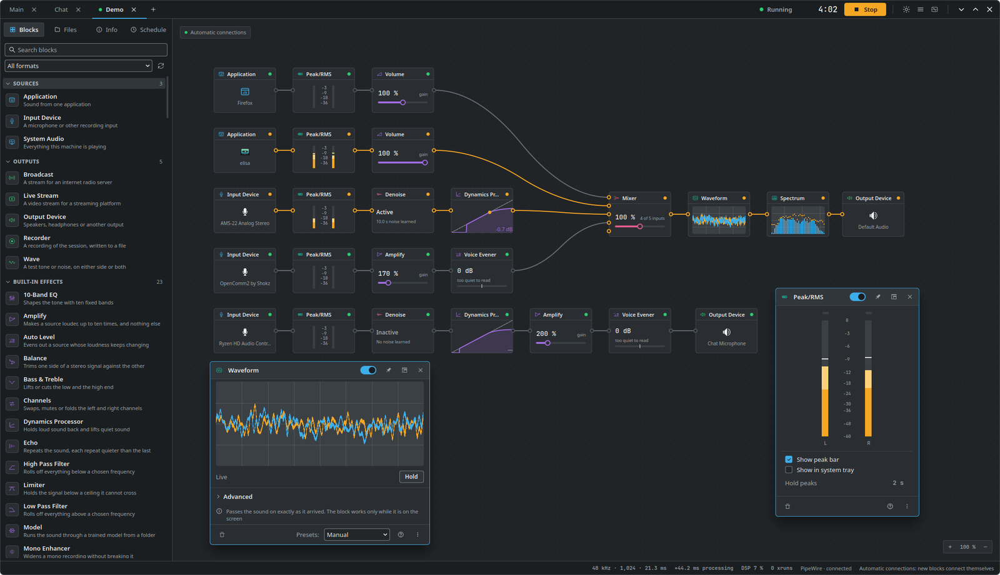
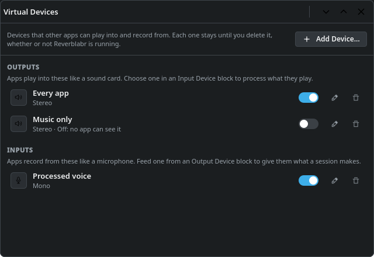
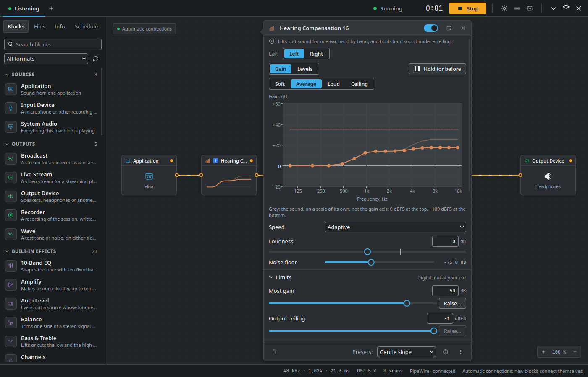

<!--
SPDX-FileCopyrightText: 2026 Reverblabr contributors
SPDX-License-Identifier: CC-BY-SA-4.0
-->

# Reverblabr

**Capture, process and route the sound on your Linux desktop.**



[Website](https://sorrelfox.github.io/reverblabr/) · [Download](https://github.com/sorrelfox/reverblabr/releases/latest) · [Documentation](docs/README.md)

Reverblabr takes sound from your applications, microphones and other devices, lets you process it with filters and effects, and sends it where you want it: to your speakers, to a file, or to another program. It runs on Linux, on the KDE Plasma desktop, with PipeWire.

Reverblabr is young and still has bugs, so please [tell me](#bugs-and-contributing) about the ones you find.

## Download and install

Take the file for your system from the [release page](https://github.com/sorrelfox/reverblabr/releases/latest), and install it from the folder you saved it in. The commands find the file by its ending, so keep one version of it there. The packages and the Flatpak are for 64-bit PCs (x86_64, also called amd64).

**Fedora 44:** the file ending in `.fc44.x86_64.rpm`

```sh
sudo dnf install ./reverblabr-*.fc44.x86_64.rpm
```

**Ubuntu 26.04 and Kubuntu 26.04:** the file ending in `.ubuntu26.04_amd64.deb`

```sh
sudo apt install ./reverblabr_*.ubuntu26.04_amd64.deb
```

**Debian testing:** the file ending in `-1_amd64.deb`

```sh
sudo apt install ./reverblabr_*-1_amd64.deb
```

**Any other distribution, with Flatpak:** the file ending in `-x86_64.flatpak`. The KDE runtime it runs on comes from Flathub:

```sh
flatpak remote-add --user --if-not-exists flathub https://dl.flathub.org/repo/flathub.flatpakrepo
flatpak install --user ./reverblabr-*-x86_64.flatpak
```

Then start Reverblabr from your application launcher. Install a package or the Flatpak, not both: the two would share one background engine.

Not every package has everything, because not every distribution packages every library Reverblabr can use, and a sandbox can't reach every part of the desktop:

| | Lacks | Why |
|---|---|---|
| Fedora 44 | nothing | |
| Debian testing | CLAP plugins | Debian has no package of the CLAP SDK. |
| Ubuntu and Kubuntu 26.04 | CLAP plugins, VST3 plugins, Speech Denoise, and the voice model Speech Now, Voice Gauge and Night Level listen with (they use a simpler detector) | Ubuntu has no package of the CLAP SDK or of RNNoise, and its VST3 SDK, 3.7, is older than 3.8, the first version under the MIT licence. |
| Flatpak | Auto Run at login, timers, KRunner, the panel widget, virtual devices for all users, the Model block, plugins installed on your system, and reconnecting after PipeWire restarts | A sandbox can't reach the parts of the desktop these need, and keeps the PipeWire socket it started with. ONNX Runtime, which the Model block needs, isn't built into it. It sees only the plugins Flathub packages for it. |

The Fedora, Debian and Ubuntu packages are built against their distribution's Qt and have to be rebuilt when it moves to a newer one; the Flatpak brings its own. None of them updates itself. [Installing](docs/installing.md) has the details: each package, checking a download, removing Reverblabr, and building it yourself.

## What it does

In Reverblabr you build sessions out of blocks. A session takes sound from sources, runs it through effects and meters, and sends it to outputs. You drag blocks onto a canvas, wire them together, and change anything while the sound is playing.

- **Sources:** a single application, a microphone or another input device, or everything the computer plays. Capturing an application doesn't move it: it keeps playing where it was, and nothing is installed into it.
- **Effects:** Volume and Amplify; Balance, Pan and Channels; Simple Compressor, Voice Compressor, Multiband Compressor, Dynamics Processor and Limiter; Auto Level, with a Voice Evener preset for calls, Night Level for films, and Voice Forward; 10-Band EQ, Bass & Treble, High Pass and Low Pass Filter; Reverb, Echo, Pitch Shift and Mono Enhancer.
- **Repair, mixing and timing:** Denoise learns a steady noise and takes it out, Speech Denoise clears noise from a voice with nothing to set up, Declick takes out clicks and crackle, and Dehum the hum of the mains. Parametric EQ shapes the tone with bands you place, and FIR Filter applies an impulse response from a file, such as a room or a correction for headphones. Mixer takes five inputs, Input Switch fades between two, Ducking turns music down under a voice, Sync lines one lane up with another, and Time Shift pauses and rewinds sound that is still arriving.
- **Hearing:** Hearing Compensation in 16 or 64 bands for each ear, which can start from an audiogram; Frequency Lowering and Frequency Raising, which move sound into a range the ear hears; Sudden Sounds, which softens clicks and knocks; One Ear Mix and Join L/R.
- **Meters:** Peak/RMS, VU, Waveform and Spectrum at any point in a lane; Sound Side shows which side is louder, Speech Now whether someone is speaking, and Voice Gauge the level of a voice against marks you place. Meters can show in the system tray too, and Speech Now and Voice Gauge in a small window over other programs.
- **Outputs:** any sound card or a virtual microphone (Output Device), a file (Recorder), an internet radio server, Icecast or SHOUTcast (Broadcast), a video streaming service over RTMP, with a picture made from a title, a logo and a display that moves with the sound (Live Stream), and a test tone or noise (Wave).
- **Model (Beta):** runs the sound through an ONNX model you keep in a folder, such as a streaming DeepFilterNet export for noise cleanup or an RVC-style voice, in a process of its own. Reverblabr includes no models and never downloads one.
- **Plugins:** LV2, LADSPA, CLAP and VST3®, each in a process of its own, with the plugin's own window where it has one, and its presets. A plugin that crashes takes nothing else down: its block is bypassed, and a button restarts it. Which package has which format is in the table above.
- **Recordings:** WAV, AIFF, FLAC, MP3, Opus and Ogg Vorbis, and AAC and Apple Lossless where your system's FFmpeg can write them, with splitting, pausing, new files by time or size, silence handling and tags. The Files tab lists everything a session recorded, to listen to, rename, tag or open in another program. A recording survives a crash.

Every block has settings of its own and presets, and all but the plugin blocks a help window that explains them. Several sessions can be open at once, one tab each, and they are saved as you work. Every change can be undone, a session can be built and run from the keyboard and with a screen reader, and the window comes in a dark and a light appearance or in your Plasma colours. [Blocks](docs/blocks.md), [Hearing](docs/hearing.md) and [Recording](docs/recording.md) have the details.

### Virtual audio devices

One thing I want to point out in particular: Reverblabr can create and delete virtual audio devices. To every other program a virtual device looks like an ordinary sound card, but there is no hardware behind it. That lets you route sound through Reverblabr before it goes anywhere:

- Send your browser, your music player or every program at once to a virtual output, process the sound in a session (an equaliser, a compressor, whatever you need), and then pass it on to your real speakers or headphones.
- Or the other way round: take your real microphone, clean it up in a session, and play it into a virtual microphone that your call or recording program uses.



The devices stay until you delete them, whether Reverblabr is running or not. [Virtual devices](docs/virtual-devices.md) explains how to set this up.

### On the desktop

- **A background engine.** Sessions run in a separate service, so they keep running with the window closed, and even if the window crashes.
- **The tray icon** lists every session with its level and a Run or Stop button, shows the meters you choose, and gets a red dot while something records.
- **Notifications** when a recording finishes, a device disconnects, an application stops or starts playing again, a plugin stops, the disk is nearly full, or a connection that would feed a session back into itself is refused.
- **Global shortcuts** run or stop each session, switch an Input Switch, control Time Shift, start a new recording file, show the window or Sound Side's strip, or have your screen reader say who is speaking or how loud a voice is. No keys are set until you choose them.
- **KRunner:** type "rb" and part of a session's name to run or stop it, or "rb rec" to see what is recording.
- **The panel widget**, Reverblabr Sessions, puts your sessions in a Plasma panel, with their levels and Run or Stop.
- **Auto Run and timers:** a session can start when you log in, or at the times you set (once, every day, Monday to Friday or on chosen days) for as long as you say, with no window open.
- **[reverblabr-ctl](docs/ctl.md)** runs, stops and changes sessions from a terminal or a script, splits recordings and lists timers, with JSON output and documented exit codes.
- **[The D-Bus API](docs/dbus-api.md)** does everything the window does, so your own programs can too.
- **In fifteen languages:** English, German, Spanish, French, Italian, Brazilian Portuguese, Russian, Polish, Japanese, Korean, Simplified and Traditional Chinese, Ukrainian, Dutch and Turkish. It speaks your desktop's language, or the one you choose in its Settings window ([Internationalization](docs/i18n.md#the-translations)).

[On the desktop](docs/desktop.md) has the details.

## Why Reverblabr

- **Your programs are left alone.** Capturing an application only adds a connection to it. It keeps playing where it was, nothing is installed into it, and the connection goes away with Reverblabr, after a crash too ([ADR-0002](docs/adr/0002-native-pipewire-and-wireplumber-as-peer.md)).
- **A plugin can't take the session down.** Every plugin runs in a process of its own. If one crashes or hangs, its block is bypassed and the sound goes on ([ADR-0014](docs/adr/0014-plugin-host-process.md)).
- **Sessions outlive the window.** They run in the background engine, with the window closed or after it crashed, and an engine that crashed opens them again when it restarts, stopped ([ADR-0017](docs/adr/0017-engine-daemon.md)).
- **Real-time rules, checked by tools.** Nothing on the audio thread allocates memory or takes a lock, and the compiler and a sanitizer check that, not only a review. A session too heavy for the computer gives way to silence instead of taking the program down ([Architecture](docs/architecture.md#real-time-rules)).
- **Changes while it plays.** Every setting can be changed while the sound runs, without clicks or gaps, and taken back with Undo.
- **Recordings survive a crash.** The file plays up to the last few seconds, and Reverblabr restores the rest when it starts again ([Recording](docs/recording.md)).
- **No feedback howl.** A connection that would feed a session's sound back into its own input is refused ([When something goes wrong](docs/troubleshooting.md#common-problems)).
- **Private.** Reverblabr doesn't use the network on its own account: no usage statistics, no update checks. Only Broadcast and Live Stream send anything, to the server you name, and their password and stream key stay in your desktop's password store, not in the session file ([Privacy](docs/privacy.md)).
- **Made for KDE and PipeWire.** It talks to PipeWire directly and leaves WirePlumber in charge, and the tray, notifications, shortcuts, KRunner, the panel widget and KWallet are the desktop's own ([ADR-0002](docs/adr/0002-native-pipewire-and-wireplumber-as-peer.md), [ADR-0004](docs/adr/0004-kde-plasma-wayland-platforms.md)).
- **Scriptable, and it stays that way.** Nothing released in the D-Bus API is taken away or changed, only added to, and a test holds it to that. The exit codes of `reverblabr-ctl` are only ever added to as well ([The D-Bus API](docs/dbus-api.md#what-stays-the-same)).
- **Accessible.** A session can be built, wired and run from the keyboard, the canvas works with a screen reader and can be shown as a list, meters are read out as progress bars, and the Reverblabr appearances meet the contrast levels of WCAG 2.1 AA ([Getting started](docs/getting-started.md#without-a-mouse)).
- **Hearing blocks with limits built in:** a ceiling for the output and for the gain, a slow rise when a limit is raised, and an extra limit where a later block could add gain ([Hearing](docs/hearing.md)).

## Who it's for

People who want to manage the sound from several devices or applications, and do more with it than the desktop's volume sliders allow. Musicians, for example, or anyone who records or streams.

I also want Reverblabr to help people with partial hearing loss, for example people who can't hear certain frequencies, or whose two ears hear differently. The blocks in the Hearing group shape the sound for each ear separately, can be set up from an audiogram, and can move sound from a range you don't hear into one you do. [Hearing](docs/hearing.md) describes them. Reverblabr isn't a medical device and doesn't replace a hearing aid, but I hope it can make everyday listening easier.



## How it started

Reverblabr is my personal project, and I work on it in my free time. I made it for myself and I use it myself.

In 2023 I gave up Apple products for Linux, tired of being told what to do and how to use my own devices. The move went well, but I missed a few programs, and most of all Audio Hijack, a macOS application for managing audio streams and applying filters to them. Nothing I found on Linux did what I needed, so I decided to write my own.

At first I wrote everything by hand, and much of the time went into learning KDE's API. After about eight months I had a first version. It ran in a terminal and could do very little, and fixing its problems took me nearly another year, so it was 2024 before it was more or less stable.

In 2025 it got its first design and became a real KDE desktop application, if a clunky one. I shared it with some people I know. They liked it, used it and kept asking for more, and the code turned into a mess. I also tried AI tools to tidy it up, but back then they didn't help much. Meanwhile I learned QML and saw that it allows designs that don't look like a typical KDE application. My first attempts were terrible, but in the end I made a friendlier version I liked, though it still had plenty of bugs.

In 2026 the tools had become good enough. They found why the program was crashing and fixed it, and helped me finish the design and bring the code into one structure. Then I could finally add the features I had wanted but never had time for, and what the people using it asked for, though not always on the first try. I keep developing it the same way: I try to write the code myself, hand some tasks to these tools, and then go over what comes back and refine it by hand.

In the middle of 2026, someone I know who had partly lost his hearing through an illness, and had to wear a hearing aid all the time, told me that nothing on Linux helped him. We gathered the data together, and from it I built the blocks for people with hearing loss.

By then the project had grown, and something I needed for myself had turned into something others could use too, not just a few friends. So I decided to release it for everyone. I'd be happy if it's useful to you.

I first wanted a GNU licence, but it would have kept commercial plugins out. I want any plugin to work in Reverblabr, so I chose the Mozilla Public License 2.0.

## Linux and KDE only

Reverblabr is developed for Linux and KDE Plasma (on Wayland). I don't plan to port it to macOS or Windows. The code is written and tuned specifically for Linux and PipeWire, rather than for something that works everywhere.

I use Fedora, so that's where I develop and test it, and its package is the one with everything. The packages for Debian testing and Ubuntu 26.04 and the Flatpak are built from the release's source and installed in a clean system before each release, but I rarely try them on a desktop.

## Building it from source

If there's no package for your system, or you'd like to work on Reverblabr, build it yourself. On Fedora 44 or newer:

```sh
git clone --branch main https://github.com/sorrelfox/reverblabr.git
cd reverblabr
sudo dnf install $(sed 's/#.*//' tools/deps/fedora.txt)
cmake --preset release -DBUILD_TESTING=OFF
cmake --build --preset release
build/release/bin/reverblabr
```

`main` holds the latest release, and development happens on the `dev` branch. [Installing](docs/installing.md#building-it-yourself) has the details, including Kubuntu, Debian and how to install a build properly, and [Getting started](docs/getting-started.md) walks you through a first session.

## Documentation

Everything else is in [docs](docs/README.md): using Reverblabr, scripting it from the command line or over D-Bus, and working on the code.

## Bugs and contributing

Bug reports are welcome. Please open an issue, say which package you installed (or that you built it yourself), and paste what **Copy Diagnostics** on the Info tab gives you ([When something goes wrong](docs/troubleshooting.md) says more). I do this in my free time, so an answer can take a while. If you'd like to contribute code, please read [CONTRIBUTING.md](CONTRIBUTING.md) first.

## Licence

The code is under the [Mozilla Public License 2.0](LICENSE). The documentation is under CC-BY-SA-4.0, and metadata and configuration files under CC0-1.0; every file names its licence in its header, following [REUSE](https://reuse.software). The name and logo are covered by [TRADEMARKS.md](TRADEMARKS.md), and third-party components are listed in [CREDITS.md](CREDITS.md).

Audio Hijack is a trademark of Rogue Amoeba Software, LLC. Reverblabr has no connection with Rogue Amoeba and is not endorsed by them.

VST is a registered trademark of Steinberg Media Technologies GmbH.
