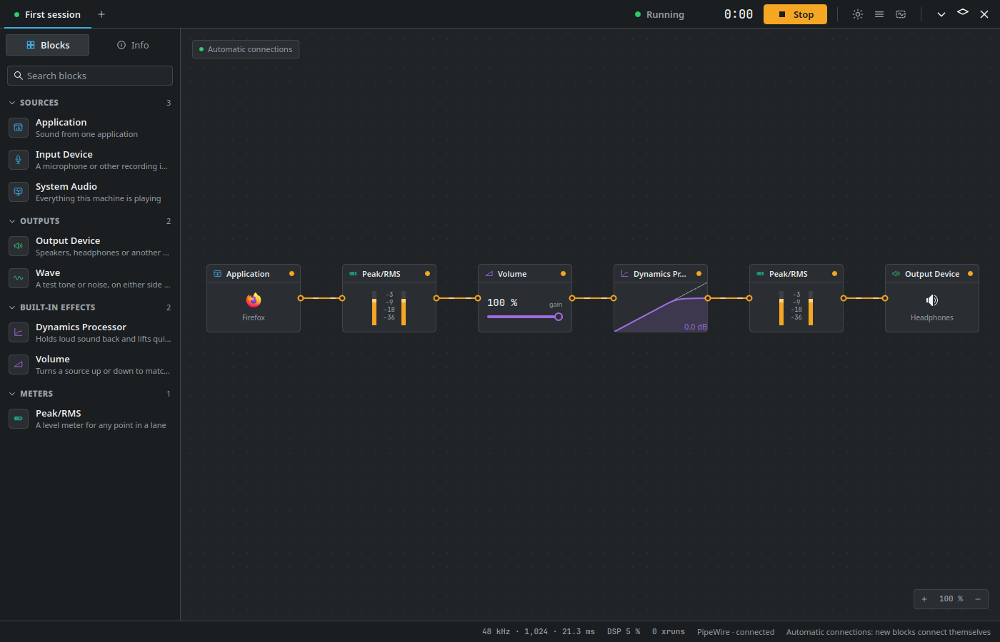

<!--
SPDX-FileCopyrightText: 2026 Reverblabr contributors
SPDX-License-Identifier: CC-BY-SA-4.0
-->

# Reverblabr

Reverblabr takes sound from your applications, microphones and other devices, lets you process it with filters and effects, and sends it where you want it: to your speakers, to a file, or to another program. It runs on Linux, on the KDE Plasma desktop, with PipeWire.



> **This is not a release yet.** Reverblabr is still in development and has plenty of bugs. There are no packages, so for now you have to build it yourself, and I wouldn't rely on it for anything important yet.

## About the project

Reverblabr is my personal project, and I work on it in my free time. I made it for myself and I use it myself. At some point I decided other people might find it interesting too, so here it is.

The inspiration was Audio Hijack, a macOS application. When I switched to Linux I missed it very much, so I decided to write my own.

I started back in 2023 on my own computer, writing everything by hand. Later AI tools came along, and with their help I brought the project to a working prototype. I keep developing it the same way: I try to write the code myself, give some tasks to AI, and then go over what comes back and refine it by hand.

## What it does

In Reverblabr you build sessions out of blocks. A session takes sound from sources, runs it through effects and meters, and sends it to outputs. You drag blocks onto a canvas, wire them together, and change anything while the sound is playing.

- **Sources:** a single application, a microphone or another input device, or everything the computer plays.
- **Effects:** volume, compressors and limiters, equalisers, filters, reverb, echo, pitch shift, noise and hum removal, and more. LV2, CLAP and LADSPA plugins work too.
- **Meters:** peak, RMS and VU meters at any point in a session.
- **Outputs:** any sound card, a file (MP3, AAC, FLAC, WAV and others), or a virtual device another program records from.

Several sessions can run at the same time, in the background, with the window closed. The tray icon shows what's running, global shortcuts control sessions from anywhere, and a session can start by itself when you log in.

### Virtual audio devices

One thing I want to point out in particular: Reverblabr can create and delete virtual audio devices. To every other program a virtual device looks like an ordinary sound card, but there is no hardware behind it. That lets you route sound through Reverblabr before it goes anywhere:

- Send your browser, your music player or every program at once to a virtual output, process the sound in a session (an equaliser, a compressor, whatever you need), and then pass it on to your real speakers or headphones.
- Or the other way round: take your real microphone, clean it up in a session, and play it into a virtual microphone that your call or recording program uses.

The devices stay until you delete them, whether Reverblabr is running or not. [Virtual devices](docs/virtual-devices.md) explains how to set this up.

## Who it's for

People who want to manage the sound from several devices or applications, and do more with it than the desktop's volume sliders allow. Musicians, for example, or anyone who records or streams.

I also want Reverblabr to help people with partial hearing loss, for example people who can't hear certain frequencies, or whose two ears hear differently. The blocks in the Hearing group shape the sound for each ear separately, can be set up from an audiogram, and can move sound from a range you don't hear into one you do. [Hearing](docs/hearing.md) describes them. Reverblabr isn't a medical device and doesn't replace a hearing aid, but I hope it can make everyday listening easier.

## Linux and KDE only

Reverblabr is developed for Linux and KDE Plasma (on Wayland). I don't plan to port it to macOS or Windows. The code is written and tuned specifically for Linux and PipeWire, rather than for something that works everywhere.

I use Fedora, so that's where I develop and test it. Kubuntu 26.04 should work as well, but I rarely test there. The first packages will be RPMs for Fedora. Packages for Debian-based distributions and a Flatpak are planned, but only some time after the first release.

## Building it

On Fedora 44 or newer:

```sh
git clone --branch dev https://github.com/sorrelfox/reverblabr.git
cd reverblabr
sudo dnf install $(sed 's/#.*//' tools/deps/fedora.txt)
cmake --preset release -DBUILD_TESTING=OFF
cmake --build --preset release
build/release/bin/reverblabr
```

Development happens on the `dev` branch, and `main` only gets releases. [Installing](docs/installing.md) has the details, including how to install it properly, and [Getting started](docs/getting-started.md) walks you through a first session.

## Documentation

Everything else is in [docs](docs/README.md): using Reverblabr, scripting it from the command line or over D-Bus, and working on the code.

## Bugs and contributing

Bug reports are welcome. Please open an issue and paste what **Copy Diagnostics** on the Info tab gives you ([When something goes wrong](docs/troubleshooting.md) says more). I do this in my free time, so an answer can take a while. If you'd like to contribute code, please read [CONTRIBUTING.md](CONTRIBUTING.md) first.

## Licence

The code is under the [Mozilla Public License 2.0](LICENSE). The documentation is under CC-BY-SA-4.0, and metadata and configuration files under CC0-1.0; every file names its licence in its header, following [REUSE](https://reuse.software). The name and logo are covered by [TRADEMARKS.md](TRADEMARKS.md), and third-party components are listed in [CREDITS.md](CREDITS.md).

Audio Hijack is a trademark of Rogue Amoeba Software, LLC. Reverblabr has no connection with Rogue Amoeba and is not endorsed by them.
