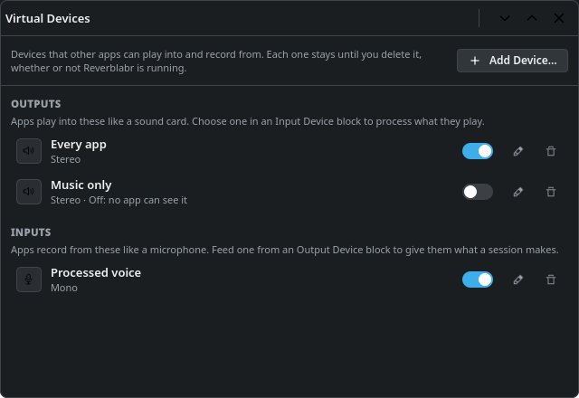

<!--
SPDX-FileCopyrightText: 2026 Reverblabr contributors
SPDX-License-Identifier: CC-BY-SA-4.0
-->

# Virtual devices

A virtual device is a sound card with no hardware behind it. Other programs see it in their device lists like any other sound card, and a Reverblabr session can record from it or play into it. That's what lets you put a session between your programs and your real sound card, in either direction:

- **A virtual output** is something programs play into. Send your browser, your music player or every program at once to it, and a session picks the sound up, runs it through whatever blocks you like (an equaliser, a compressor, the hearing blocks), and plays the result on your real speakers or headphones.
- **A virtual input** is a microphone that programs record from. A session takes your real microphone, cleans it up and plays it into the virtual one, and your call or recording program uses that as its microphone.

You can make as many of each as you need and delete them again when you're done.

## Making and deleting devices

Open the **Virtual Devices** window with its button at the right end of the top row, or with **Settings → Virtual Devices…**. It has two lists, **Outputs** and **Inputs**.

- **Add Device…** asks for a name, the kind (**Output** or **Input**), **Stereo** or **Mono**, and who the device is for (see [Devices for all users](#devices-for-all-users)).
- Each row has a switch, a button to rename the device (or double-click the name, or press F2) and a button to delete it.
- A device that is switched off stays in the list, but programs can't see it. Programs that were using it move to another device.

Virtual devices belong to your desktop, not to a session and not to Reverblabr:

- **They stay** until you delete them, whether Reverblabr is running or not, and they come back after a restart.
- **Renaming one doesn't break anything.** Programs playing into it carry on, and blocks that use it keep using it.
- **They are silent on their own.** Sound sent to a virtual output goes nowhere until a running session picks it up and plays it somewhere. Reverblabr never starts a session by itself, so when no session is running, move your programs back to your real sound card (or set a session to [run at login](desktop.md#sessions-that-run-when-you-log-in)).

## Process the sound of your programs

This sends programs through a session before you hear them.

1. In **Virtual Devices**, add an **Output**, for example "Every app".
2. In the Plasma audio applet, make it your default output, or move only the programs you want to process onto it.
3. In a session, add an **Input Device** block, and in its settings choose your new device. Virtual devices are listed at the end, under **Virtual devices**.
4. Add the effects and meters you want after it.
5. End the lane with an **Output Device**, and choose your real speakers or headphones **by name**. Left on *Default output*, it would follow the default to the virtual device, which is the session's own input.
6. Press **Run**.

Reverblabr refuses a connection that would feed a session's sound back into its own input, and tells you so, because that sound would go round and round, louder every time. If you see that message, check the Output Device.

Compared with capturing a single application, this way nothing is heard twice, and you can process several programs together or set up a different session for each.

## Process your microphone for other programs

This puts your voice through a session before your call or recording program gets it.

1. In **Virtual Devices**, add an **Input**, for example "Processed voice". **Mono** is right for a voice.
2. In a session, add an **Input Device** block and choose your real microphone **by name**. *Default input* would follow the default to the virtual microphone, if you made that the default.
3. Add the effects you want, for example a Dynamics Processor or a Speech Denoise, and a Peak/RMS meter to watch the level.
4. End the lane with an **Output Device**, and choose your virtual microphone under **Virtual devices**.
5. Press **Run**.
6. In your call or recording program, choose the virtual microphone.

A session like this is a good candidate for [Auto Run](desktop.md#sessions-that-run-when-you-log-in), so that the processed microphone is simply there after you log in.

## Devices for all users

**Only Me** is the usual choice when you add a device, and it needs nothing more. **All Users** makes the device for every account on the computer, and asks for an administrator's password. The password is remembered for a few minutes, so a few changes in a row only ask once. Devices for all users have a padlock in the list. Other users get the device the next time they log in.

This needs a small helper that runs as root. A full install includes it; if you run Reverblabr from the build tree, [Installing](installing.md#virtual-devices-for-all-users) says how to install just the helper. Until it's installed, choosing All Users only tells you that it is missing.

## Removing Reverblabr

Uninstalling Reverblabr doesn't remove its virtual devices: PipeWire keeps making them at every login. Delete them in the Virtual Devices window first. If Reverblabr is already gone, delete the files PipeWire makes them from, then log out and back in:

- your own devices: `~/.config/pipewire/pipewire.conf.d/90-reverblabr-virtual-devices.conf`
- devices for all users: `/etc/pipewire/pipewire.conf.d/90-reverblabr-virtual-devices-system.conf` (as root)
